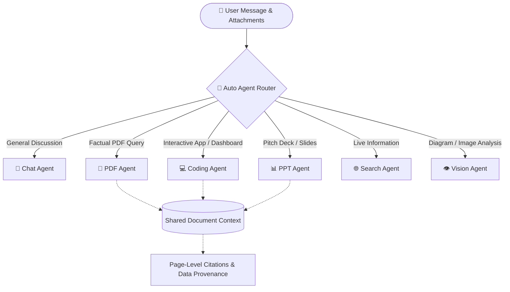

<div align="center">

# 🪐 Orbit AI

**Autonomous Multi-Agent Workspace & Cross-Agent RAG Platform**

[](https://orbitai-agents.vercel.app/)
[](https://react.dev/)
[](https://nodejs.org/)
[](https://langchain.com/)
[](https://www.mongodb.com/)
[](https://upstash.com/)

[**Explore Live Workspace →**](https://orbitai-agents.vercel.app/)

</div>

---

## 📌 Overview

**Orbit AI** is a production-grade, multi-agent AI workspace built on the MERN stack, LangGraph, and modern GenAI architectures. 

Instead of forcing users to switch between separate AI tools for chatting, coding, building slide decks, or researching PDFs, Orbit provides an **Autonomous Multi-Agent System with Shared Cross-Agent RAG**: **upload a document once**, and seamlessly let Orbit's agents synthesize code, structure presentation decks, or conduct research across the same session without losing context.

---

## 🤖 The Orbit Agent Arsenal

Orbit provides **7 specialized agent modes** accessible via the composer mode selector or handled automatically:

| Agent Mode | Icon | Role & Specialty |
| :--- | :---: | :--- |
| **Auto Agent** *(Default)* | 🧠 | **Autonomous Multi-Agent Routing**: Dynamically inspects intent, context, and attachments to select the optimal specialist. |
| **Chat Agent** | 💬 | **Direct Conversational Assistant**: Deep reasoning, brainstorming, general Q&A, and math with full turn memory. |
| **Coding Agent** | 💻 | **Full-Stack Sandboxing**: Generates multi-file React apps, live Sandpack preview, version history, and ZIP export. |
| **PPT Agent** | 📊 | **Slide Deck Generation**: Designs structured presentation outlines, slide citations, speaker notes, and `.pptx` export. |
| **PDF Agent** | 📄 | **Grounded Document RAG**: Page-aware hybrid retrieval (Atlas Vector Search + BM25), OCR preservation, and citations. |
| **Search Agent** | 🌐 | **Fact-Checked Web Research**: Live web search powered by Tavily with verified interactive source cards. |
| **Vision Agent** | 👁️ | **Multimodal Inspection**: High-precision image, diagram, screenshot, and architectural chart analysis via Gemini Vision. |

---

### Detailed Agent Profiles

#### 1. 🧠 Auto Agent (Autonomous Intent Engine)
- The default mode in Orbit. You don't have to manually pick which agent to use.
- Uses a **LangGraph-driven intent classifier**:
  - Attaching a PDF with *"Build a dashboard for this report"* ➔ routes to **Coding Agent**.
  - Attaching a PDF with *"Turn this into a pitch deck"* ➔ routes to **PPT Agent**.
  - Attaching a PDF with *"What was our Q3 EBITDA?"* ➔ routes to **PDF Agent**.
  - Asking open-ended questions or code explanations ➔ routes to **Chat Agent**.
  - Inquiring about current events ➔ routes to **Search Agent**.
- Handles seamless multi-turn intent switches without losing conversational memory.

#### 2. 💬 Chat Agent (Conversational Intelligence)
- Built for open-ended brainstorming, complex reasoning, logic puzzles, drafting, and programming advice.
- Context-aware multi-turn conversational memory loaded via LangChain and MongoDB.
- Real-time token streaming with instant Time-to-First-Token (TTFT) and graceful interruption.

#### 3. 💻 Coding Agent (Full-Stack Sandbox & Live Preview)
- Generates complete, responsive React applications and live KPI dashboards.
- Embedded in-browser **Sandpack IDE** runtime with instant interactive preview, console inspector, and responsive viewports (Desktop, Tablet, Mobile).
- **Lineage & Version History**: Tracks incremental modifications, provides visual file-by-file diffs, version rollback, and single-click `.zip` export.
- **Document-Grounded Dashboards**: Translates raw figures and tabular data from uploaded PDFs into live charting apps with page-level citations.

#### 4. 📊 Presentation (PPT) Agent
- Automatically designs professional, multi-slide pitch decks and executive briefings.
- Generates slide titles, key takeaways, speaker notes, and slide-level evidence references.
- Interactive slide deck carousel with theme styling and native **`.pptx` PowerPoint file export**.
- Grounded context protection: never fabricates metrics if document context is missing.

#### 5. 📄 PDF Intelligence & Document Agent
- **Hybrid Retrieval Pipeline**: Combines MongoDB Atlas vector search (dense semantic embeddings) with keyword retrieval (BM25 lexical matching) fused via **Reciprocal Rank Fusion (RRF)**.
- **Visual Evidence Extraction**: Page-aware extraction with OCR, chart, and table structure preservation.
- **Side-by-Side Artifact Panel**: View extracted document content and navigate citations directly to source page numbers.

#### 6. 🌐 Real-Time Web Research Agent
- Real-time search engine integration powered by Tavily.
- Synthesizes search results into structured briefings with interactive source cards and live URLs.

#### 7. 👁️ Vision Intelligence Agent
- Multimodal chart, UI, and image analysis using Gemini multimodal vision models.

---

## ⚡ Cross-Agent RAG Workflow



1. **Upload Once**: Upload a financial statement, legal contract, or research report.
2. **Factual Inquiry**: Query specific figures with the PDF Agent.
3. **App Synthesis**: Ask *"Build a dashboard visualizing the Q3 revenue metrics from this PDF"* — the Coding Agent retrieves the ground-truth data, synthesizes the React project, and mounts the live preview.
4. **Deck Export**: Ask *"Create a 5-slide pitch deck highlighting the key risks from the report"* — the PPT Agent constructs the deck and prepares the `.pptx` download.

---

## 🛡️ Production Reliability & Architecture

- **Server-Sent Events (SSE) Streaming**: Real-time token and progress streaming with robust disconnect recovery and idempotency (`Idempotency-Key` headers).
- **Resilient Multi-Provider Fallbacks**: Primary execution on high-throughput Groq models (Llama 3.3 70B, Qwen 2.5 32B) with automatic failover to Google Gemini (Gemini 2.5 Flash).
- **Distributed Concurrency & Rate Limiting**: Upstash Redis token-bucket daily quota enforcement and atomic concurrency leases to prevent runaway costs and server starvation.
- **Untrusted Context Guardrails**: Injected PDF instructions are treated as untrusted data references, neutralizing prompt-injection exploits.
- **Tenant Isolation**: Strict MongoDB and Redis scoping prevents cross-user document or session leakage.

---

## 🛠️ Technology Stack

| Layer | Technologies |
| :--- | :--- |
| **Frontend** | React 19, Vite 8, Tailwind CSS, TanStack Query v5, Framer Motion, Lucide Icons, Sandpack |
| **Backend & Microservices** | Node.js (ESM), Express, LangGraph, LangChain, Mongoose |
| **Databases & Cache** | MongoDB Atlas (Vector Search Index), Upstash Redis |
| **AI Models & Embeddings** | Groq (Llama-3.3-70b-versatile, Qwen-2.5-32b), Google Generative AI (Gemini 2.5 Flash, Text Embedding 004) |
| **Auth & Security** | Firebase Authentication, HttpOnly Secure JWT Session Cookies |
| **Deployment** | Vercel (Frontend), Node.js Production Cluster (Backend) |

---

## 📁 Repository Structure

```
Orbit-Ai/
├── Frontend/                      # Vite + React 19 SPA
│   ├── src/
│   │   ├── components/            # UI, Chat, Artifact Panels, Sandpack, SlideDeck
│   │   ├── features/              # TanStack Query hooks, Auth, and Conversation State
│   │   ├── lib/                   # ZIP exporter, PPTX generator, Code Preview Bundler
│   │   └── pages/                 # Main Workspace (Home.jsx)
├── Backend/
│   ├── gateway/                   # Express Gateway & Reverse Proxy
│   ├── services/
│   │   ├── auth/                  # Authentication Service & Session Handlers
│   │   ├── chat/                  # Chat Persistence & Message Models
│   │   └── agent/                 # Agent Microservice
│   │       ├── agents/            # Auto, Chat, Coding, PPT, PDF, Vision, & Search Agents
│   │       ├── graph/             # LangGraph State Machine & Intent Router
│   │       ├── pdf/               # Shared Document Context, Hybrid Retrieval & Chunking
│   │       └── test/              # 100+ Automated Regression & Acceptance Test Suites
│   └── start-production.js        # Multi-service Production Cluster Orchestrator
└── README.md
```

---

## 🏁 Getting Started

### Prerequisites
- **Node.js**: v20.x or higher
- **MongoDB**: Atlas cluster with Vector Search index enabled
- **Redis**: Upstash Redis instance (REST or TCP)
- **API Keys**: Groq API Key, Google Gemini API Key, Tavily API Key (optional for search)

### 1. Clone the Repository
```bash
git clone https://github.com/Prateek-rajput-007/Orbit-Ai.git
cd Orbit-Ai
```

### 2. Environment Configuration

Create `.env` in `Backend/services/agent/`, `Backend/services/chat/`, `Backend/services/auth/`, and `Frontend/`:

```env
# Agent Service (.env)
PORT=8003
MONGO_URI=mongodb+srv://<user>:<password>@cluster.mongodb.net/orbit
UPSTASH_REDIS_REST_URL=https://<your-upstash-instance>.upstash.io
UPSTASH_REDIS_REST_TOKEN=<your-token>
GROQ_API_KEY=<your-groq-key>
GEMINI_API_KEY=<your-gemini-key>
TAVILY_API_KEY=<your-tavily-key>

# Frontend (.env)
VITE_SERVER_URL=http://localhost:8000
```

### 3. Install Dependencies
```bash
# Install Backend Services
cd Backend/gateway && npm install
cd ../services/auth && npm install
cd ../services/chat && npm install
cd ../services/agent && npm install

# Install Frontend
cd ../../../Frontend && npm install
```

### 4. Run Development Servers
```bash
# Terminal 1: Run Backend Production Cluster
cd Backend
node start-production.js

# Terminal 2: Run Frontend Vite Dev Server
cd Frontend
npm run dev
```

Visit `http://localhost:5173` to launch the Orbit AI workspace.

---

## 🧪 Automated Test Suite

Orbit includes comprehensive automated regression suites covering routing, grounding, and concurrency:

```bash
cd Backend/services/agent

# Run all core verification suites
node --test test/cross_agent_routing.test.js
node --test test/cross_agent_document_context.test.js
node --test test/cross_agent_coding_document_context.test.js
node --test test/cross_agent_ppt_document_context.test.js
node --test test/sse_concurrency_lifecycle.test.js
```

---

## 🌐 Live Deployment

Orbit AI is live and publicly accessible:  
🔗 **[https://orbitai-agents.vercel.app/](https://orbitai-agents.vercel.app/)**
